# Enterprise Chat

Windows 桌面端企业协作与即时通讯原型。系统由 Electron 客户端、Egg.js 服务端、Socket.IO 实时通信服务和 SQLite 数据层组成，当前覆盖企业通讯录、单聊/群聊、消息与文件、云文档协作、组织管理以及机器人 Webhook 等能力。

## 项目效果图

以下包含新版工作台外观及已有功能示例，均取自 renderer 页面，使用独立演示数据，不包含 Electron 原生窗口边框。图片保存在 `docs/screenshots/`，可点击查看原图。

### 新版工作台：亮暗主题

统一导航、控件和消息排版；深色模式使用中性灰阶区分背景与选中态。

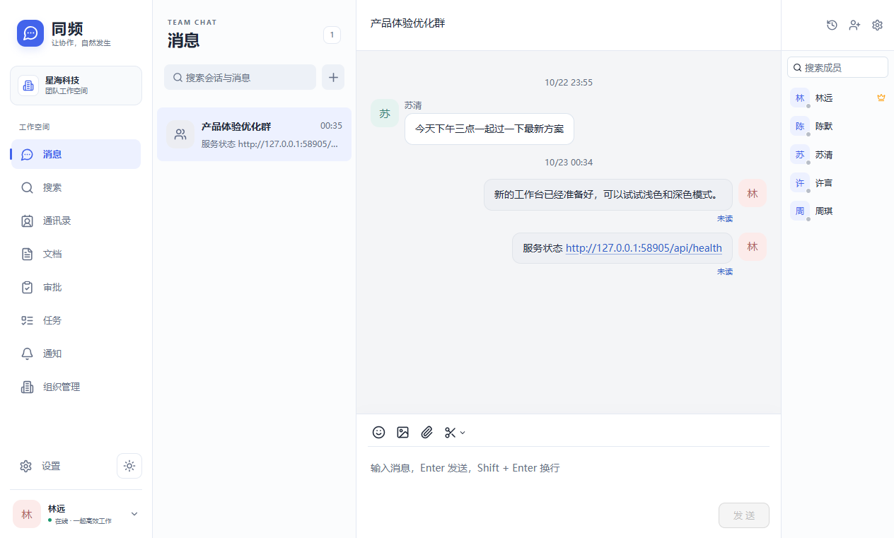

<details>
<summary>查看深色模式</summary>

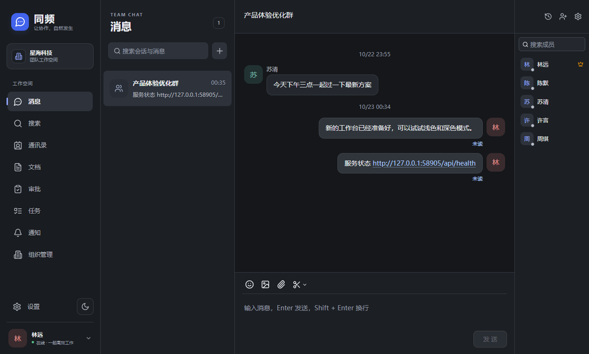

</details>

### 即时通讯

群聊、成员列表、消息编辑与可点击链接集中在同一工作空间。

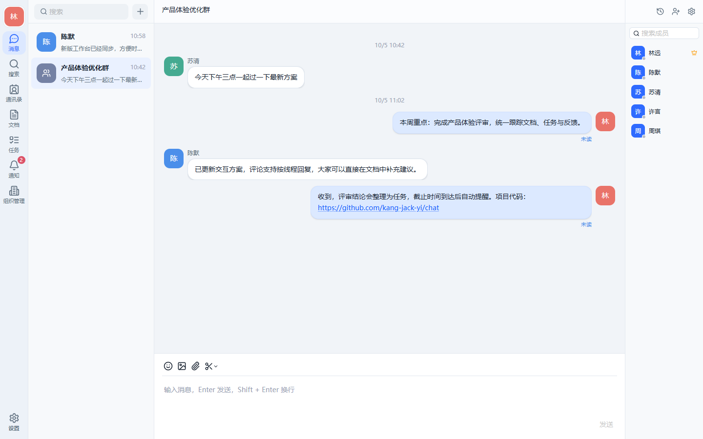

<details>
<summary>登录、企业通讯录与组织管理</summary>

### 登录与企业空间

支持员工登录、创建企业和配置服务器地址。

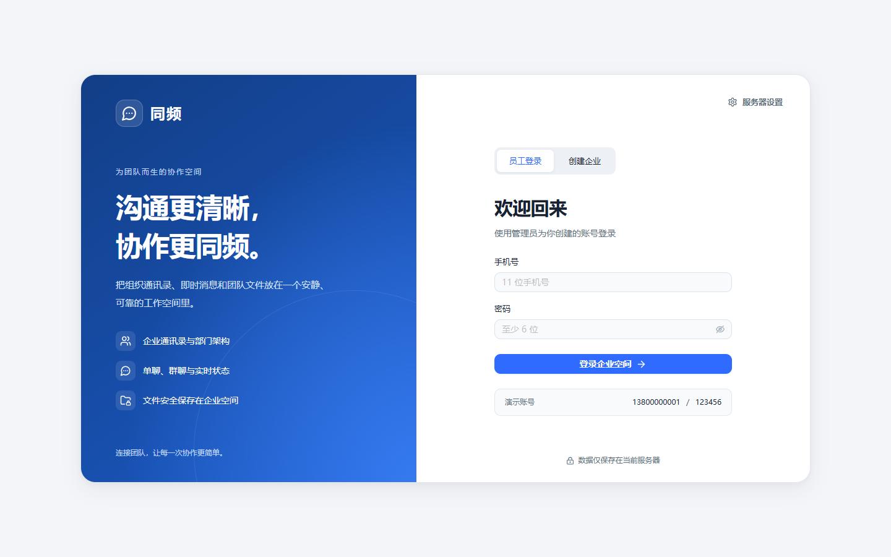

### 企业通讯录

查看成员资料、部门与联系方式，并从成员资料发起聊天。

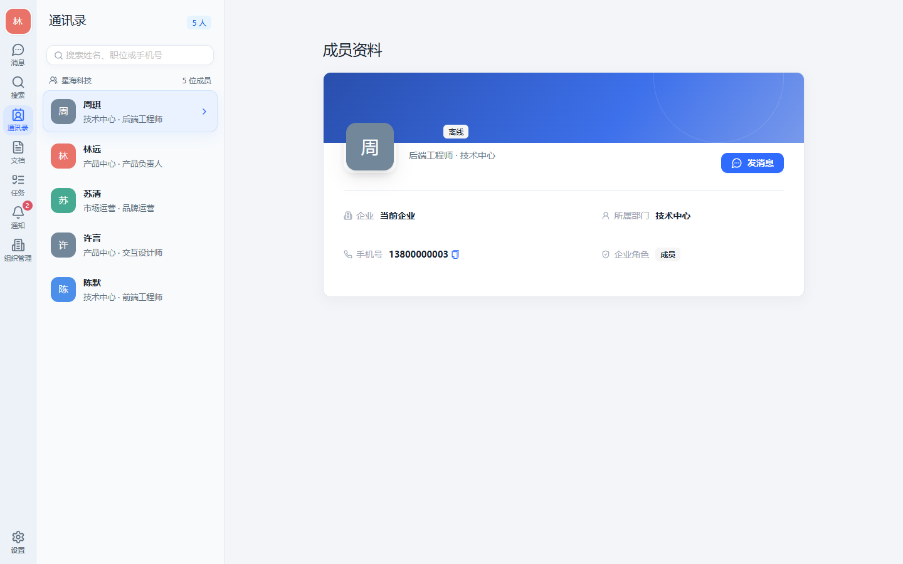

### 组织管理

管理员可查看组织概览，管理成员账号、角色与部门。

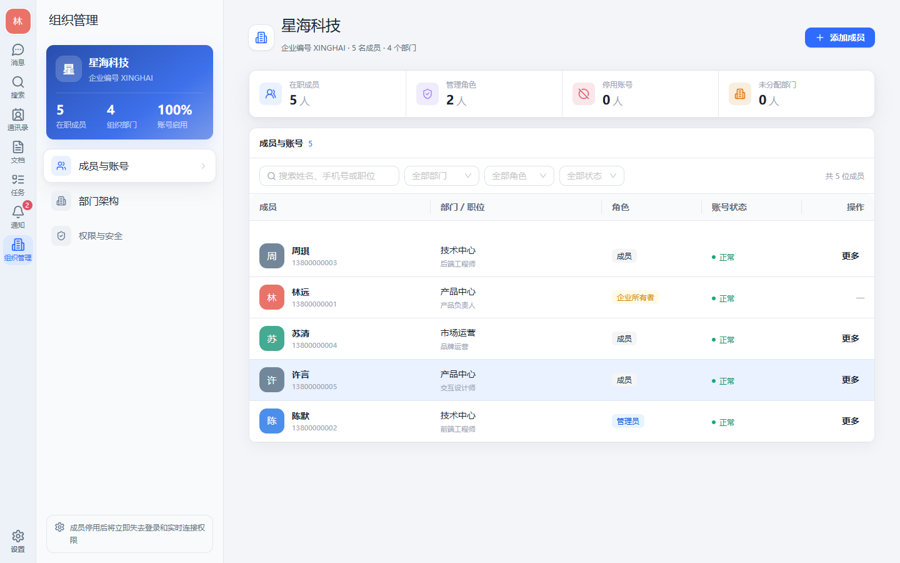

</details>

<details>
<summary>云文档、评论线程与版本历史</summary>

### 云文档

统一管理在线文档与表格，支持最近访问、共享与收藏。

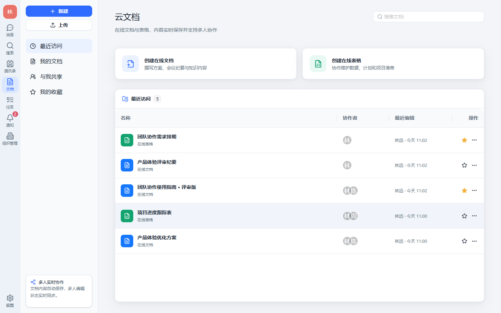

### 评论回复与线程

按线程讨论文档内容，支持筛选未解决/已解决线程，以及整线程解决和重新打开。

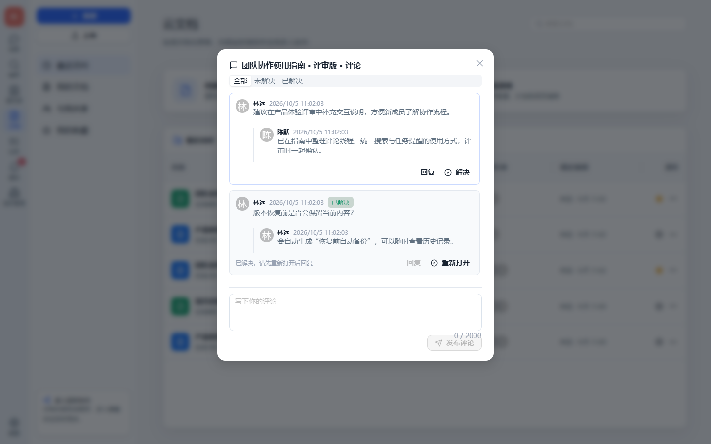

### 版本历史

保存命名版本、预览历史内容并恢复版本；恢复前需关闭编辑窗口，系统会自动备份当前内容。

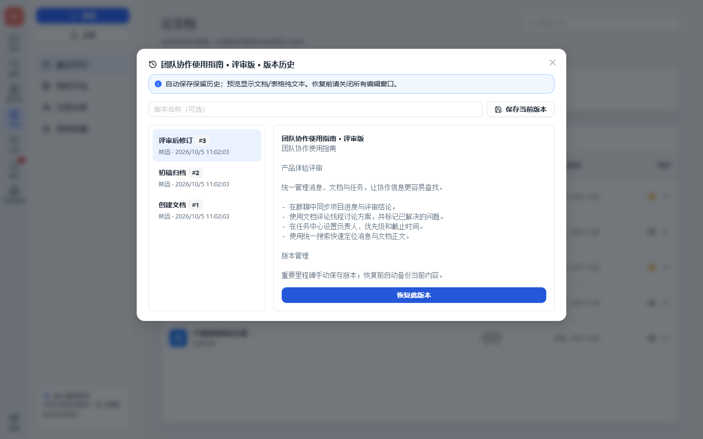

</details>

<details>
<summary>任务中心、到期提醒与统一搜索</summary>

### 任务中心

集中管理负责人、优先级、截止时间与任务状态，并标识逾期事项。

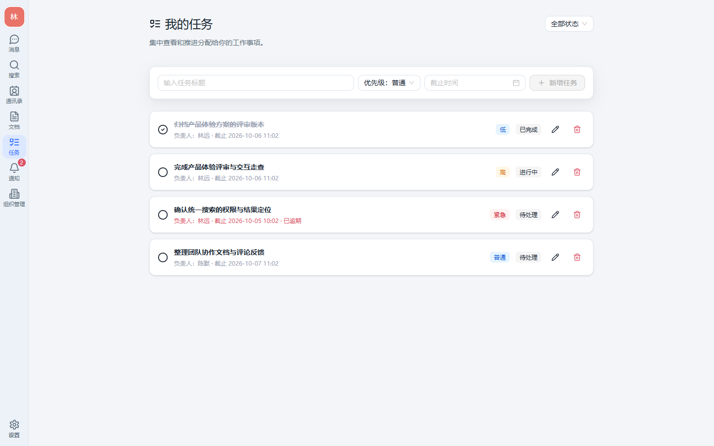

### 通知与到期提醒

任务到期提醒与文档评论通知汇集到通知中心，支持未读筛选和标为已读。

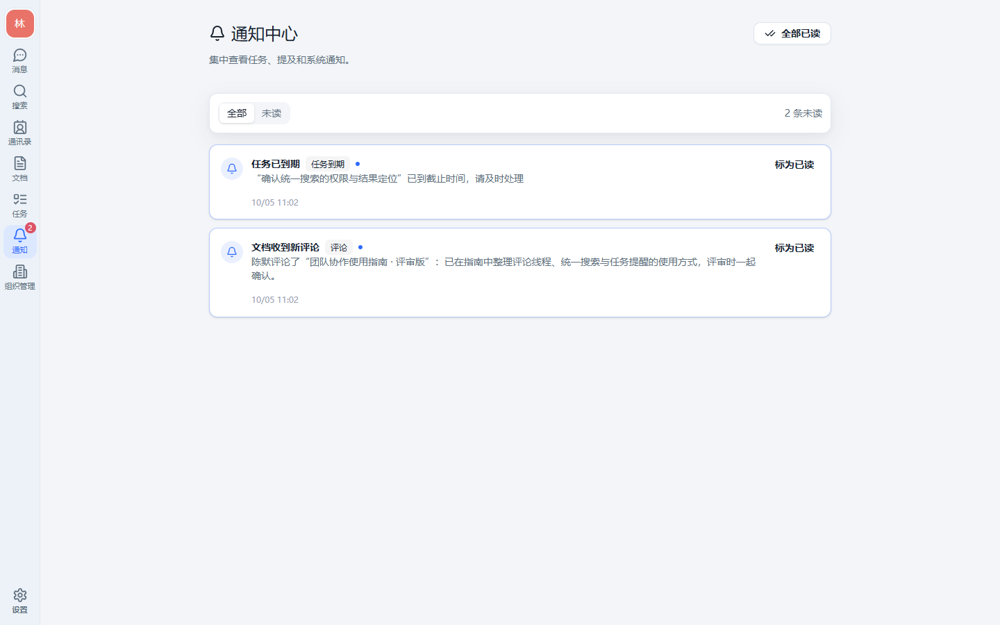

### 统一搜索

在当前用户权限范围内搜索消息、文档标题与正文、成员、任务和通知；下图同时展示通知、任务、文档正文和消息结果。

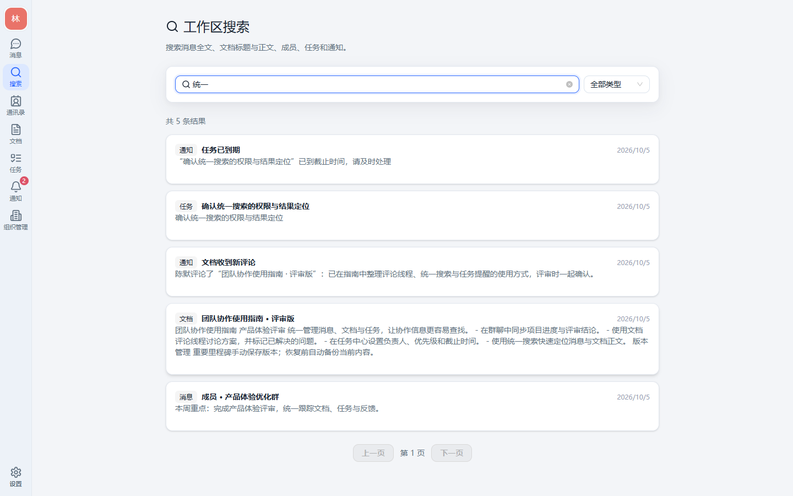

</details>

## 当前已有功能

### 工作台布局与外观

- 宽屏显示文字导航，窄窗口切换为紧凑导航；页面标题、工具栏、表单和列表使用统一排版。
- 侧栏聚合为消息、搜索、团队、文档、工作中心五个入口，支持手动折叠并记住本机选择。
- “工作中心”集中切换任务、审批和通知；通知未读数量同步展示在入口和通知视图。状态筛选、审批范围和未读筛选随 URL 保留，视图往返时恢复最近的定位。
- “团队”整合通讯录与组织管理，管理员可在同一处管理成员、账号和部门；普通成员只显示通讯录。原有联系人、任务、审批和通知链接继续有效。
- 导航底部可直接切换浅色、深色或跟随系统，也可在“设置 → 外观设置”中调整；桌面偏好持久保存并同步到聊天记录、云文档等独立窗口。
- 深色界面使用中性灰阶区分背景、卡片、选中和悬停状态，消息气泡不再使用浅蓝底；HTTP/HTTPS 链接保留蓝色标识并交给系统浏览器打开。

### 1. 登录、企业与个人账号

- 企业注册和初始化企业空间。
- 手机号/密码登录、刷新登录态、退出登录。
- 当前用户信息查询和修改。
- 头像上传与头像读取。
- 个人简介、工作邮箱、职位/部门信息展示。
- 在线状态设置：在线、忙碌、请勿打扰、离开。
- 状态文本和状态有效期设置。
- 企业所有者、管理员、普通成员三类角色。
- 服务端地址配置和服务健康检查。

相关实现：`apps/desktop/src/renderer/pages/Login`、`apps/server/app/controller/auth.ts`、`apps/server/app/controller/organization.ts`。

### 2. 企业通讯录

- 企业成员列表和成员搜索。
- 按部门筛选成员。
- 成员详情页：头像、姓名、职位、部门、联系方式和个人简介。
- 从成员详情直接发起单聊。
- 组织管理员可查看企业成员与部门概览。

相关实现：`apps/desktop/src/renderer/pages/Contacts`、`apps/server/app/controller/organization.ts`。

### 3. 组织架构与成员管理

管理员/企业所有者可以：

- 查看企业基本信息、成员数量和部门数量。
- 创建、编辑、删除部门。
- 设置部门层级和上级部门。
- 新增成员账号。
- 编辑成员姓名、邮箱、职位、部门和角色等信息。
- 重置成员密码。
- 启用或停用成员账号。
- 按关键词、部门、角色、账号状态筛选成员。
- 查看活跃成员、管理员、停用账号、未分配部门等统计。

相关实现：`apps/desktop/src/renderer/pages/Organization`、`apps/server/app/controller/organization.ts`。

### 4. 单聊与群聊

- 发起单聊；同一企业内同一对成员复用已有单聊会话。
- 创建群聊并选择多个企业成员。
- 群成员列表、成员邀请和成员移除。
- 群聊名称修改。
- 群主转移。
- 群主解散群聊；普通成员退出群聊。
- 群公告发布、编辑和展示。
- 会话置顶、消息免打扰、隐藏会话。
- 清空当前账号可见的本地聊天记录。
- 会话未读数、@提及状态和单聊在线状态。
- 会话列表按置顶和最近消息排序。

相关实现：`apps/desktop/src/renderer/pages/Chat`、`apps/server/app/controller/chat.ts`。

### 5. 消息能力

- 富文本消息编辑。
- 文本、图片和文件消息。
- 图片粘贴、拖拽/选择上传和发送前预览。
- 多附件批量发送。
- 消息引用和引用内容预览。
- @成员和 @全体成员。
- 消息多选、复制文本、批量保存图片。
- 单条消息或多条消息转发到多个会话。
- 撤回已发送消息。
- 仅对当前账号删除消息。
- 历史消息分页加载和向上加载更早消息。
- 消息已读回执和群成员阅读详情。
- 发送中、上传中、失败、重试、取消等发送状态。
- 系统消息：建群、入群、改名、转让群主、成员变更、撤回消息等。

共享消息模型定义在 `packages/shared/src/index.ts`，核心服务实现位于 `apps/server/app/lib/chat.ts` 和 `apps/server/app/controller/chat.ts`。

### 6. 消息搜索与历史

- 当前账号范围内的本地全文搜索。
- 全局搜索会话和消息。
- 工作区统一搜索消息、文档标题与正文、成员、任务和通知，支持类型筛选与分页。
- 支持按消息内容、发送者、会话等上下文定位结果。
- 支持消息历史分类：全部、文件、媒体。
- 从搜索结果定位到具体会话和消息。
- 会话历史清空后按账号维度隐藏历史，不影响其他成员的记录。

相关实现：`apps/desktop/src/renderer/pages/Chat/hooks.ts`、`ConversationList.tsx`、`apps/server/app/lib/database.ts`、`apps/server/app/lib/chat.ts`。

### 7. 会话机器人与 Webhook

- 在单聊或群聊中创建机器人。
- 修改机器人名称。
- 删除机器人。
- 重置机器人 Webhook 密钥。
- 复制机器人 Webhook 地址。
- 通过 Webhook 向会话发送文本、图片和文件消息。
- 机器人消息会显示独立的发送者身份。
- 支持 Webhook 媒体上传接口，并对临时媒体设置过期时间。

相关实现：`apps/desktop/src/renderer/pages/Chat/components/ConversationBotsModal.tsx`、`apps/server/app/controller/conversation_bot.ts`。

Webhook 入口：

```text
POST /cgi-bin/webhook/send
POST /cgi-bin/webhook/upload_media
```

### 8. 云文档与在线表格

- 创建在线文档。
- 创建在线表格。
- 导入本地 Word、Excel、CSV、TSV、Markdown、RTF、TXT 等文件。
- 最近访问、我的文档、与我共享、我的收藏四种列表视图。
- 文档搜索。
- 文档收藏/取消收藏。
- 文档重命名。
- 文档下载/导出。
- 文档分享给企业成员。
- 文档成员权限：所有者、可编辑、仅查看。
- 所有者删除文档并移入回收状态。
- 在独立 Electron 文档窗口打开文档。
- 文档标题和内容自动保存。
- 自动保留版本快照，支持保存命名版本和查看历史内容的纯文本预览。
- 关闭编辑窗口后可恢复历史版本，恢复前自动备份当前内容。

相关实现：`apps/desktop/src/renderer/pages/Documents`、`apps/desktop/src/document`、`apps/server/app/controller/documents.ts`。

在线编辑器基于 Tiptap、Yjs 和 Hocuspocus，当前支持：

- 多人实时协同编辑。
- 协作者光标和在线状态展示。
- 文本、标题、列表、引用、链接、表格、文本对齐和高亮等编辑能力。
- 表格/表单式在线表格编辑基础能力。
- 查看模式和只读权限控制。
- 协作状态展示：连接中、已连接、已同步、已断开。
- 窗口关闭前刷新未同步更新。

### 9. 本地缓存、离线发送与增量同步

- 每个服务端/企业/用户组合拥有独立的本地 SQLite 数据库。
- 本地保存用户、部门、会话、消息、附件和同步游标等数据。
- 聊天消息支持先写入本地，再通过 outbox 异步发送。
- 网络恢复后按 `clientId` 去重并重试未完成消息。
- Socket.IO 推送实时消息和同步提示。
- 服务端通过持久化 `sync_events` 增量补偿客户端离线期间的变更。
- 首次登录或本地副本过期时执行 bootstrap，同步通讯录、会话、消息和快捷数据。
- 后台分批补齐历史消息并建立本地全文索引。
- 支持清空当前账号本地数据。
- 退出账号默认保留本地历史；用户主动清理时才删除本地数据。

本地数据目录：

```text
%APPDATA%/EnterpriseChat/
├─ settings.json
├─ data/{serverId}/{companyId}/{userId}/chat.db
└─ cache/{serverId}/{companyId}/{userId}/
```

### 10. 任务/待办中心

- 从消息右键菜单创建任务，并保留关联会话和原消息。
- 独立“我的任务”页面。
- 任务负责人、截止时间、优先级和状态管理。
- 支持待处理、进行中、已完成、已取消四种状态。
- 支持按状态筛选任务。
- 支持推进任务、完成任务和重新打开任务。
- 支持编辑任务、调整负责人、优先级和截止时间。
- 支持删除任务，并在列表中标识逾期任务。
- 每分钟扫描已到期的未完成任务，按任务、截止时间和负责人去重提醒。
- 创建任务和完成任务时向关联会话写入系统消息。
- 任务通过服务端 API 保存，并为负责人写入增量同步事件。

相关实现：`apps/server/app/controller/tasks.ts`、`apps/desktop/src/renderer/pages/Tasks`、`apps/desktop/src/renderer/pages/Chat/components/CreateTaskModal.tsx`。

### 11. 通知中心

- 任务分配时向负责人生成通知，任务完成时向创建者生成通知。
- 未完成任务到达截止时间时，向当前负责人生成去重的到期提醒。
- 群聊中 @成员 或 @所有人 时，为对应活跃成员生成通知。
- 文档成员发表评论时，向其他文档成员生成评论通知。
- 通知按接收人隔离，支持全部通知/未读通知筛选。
- 支持侧栏未读数、单条标为已读和全部已读。
- 点击消息通知可直接打开对应会话，点击任务通知可打开任务中心。
- 通过 Socket 通知到达事件刷新未读状态。

相关实现：`apps/server/app/controller/notifications.ts`、`apps/server/app/lib/notifications.ts`、`apps/desktop/src/renderer/pages/Notifications`。

当前仍待补充更多系统通知类型。

### 12. 文档评论

- 文档成员可以发表评论，支持可选的段落锚点标识。
- 支持查看评论、标记解决和重新打开评论。
- 支持评论回复线程、全部/未解决/已解决筛选，以及整线程解决和重新打开。
- 评论通知按文档成员隔离，点击通知可打开对应文档。
- 文档列表的操作菜单提供评论面板，可直接发布和处理评论。

相关实现：`apps/server/app/controller/documents.ts`、`apps/desktop/src/renderer/pages/Documents/components/DocumentCommentsModal.tsx`。

当前仍待补充编辑器选区直接绑定评论锚点。

### 13. 桌面端能力与安全边界

- Electron 主进程、preload、renderer 分层。
- renderer 不直接访问 Node.js、SQLite 或真实文件路径。
- 通过白名单 IPC 暴露文档窗口、附件、剪贴板、截图和下载等桌面能力。
- 支持独立文档窗口和辅助窗口。
- 支持窗口关闭前等待协同文档更新刷出。
- 服务端通过 Bearer access token 认证，refresh token 使用 HttpOnly Cookie。
- access token 默认有效期 15 分钟，刷新时轮换 refresh session。
- 会话、消息、文档、附件和组织数据均按企业/成员权限隔离。

### 14. 文档评审与固定审批闭环

- 文档列表的操作菜单中，所有者和编辑者可以“提交评审”。
- 选择关联群聊、指定审批人、任务负责人和截止时间；参与者必须是同企业有效成员，并同时有文档与群聊权限。
- 提交时保存不可变文档版本，后续编辑不改变本次审批依据。
- “审批”页面提供待我审批、我发起的和全部参与记录，展示提交版本的纯文本预览。
- 指定审批人通过或驳回评审，可填写审批意见；通过后自动创建任务、分配通知和群系统消息，失败原子回滚。
- 重复提交和重复审批按请求标识与终态去重；通知可直接定位评审详情。
- 指定审批人仍有评审访问权时，可只读查看自动任务；任务修改仍限创建者和负责人。
- 评审任务到期后通知负责人并向关联群聊写入系统提醒，投递凭据持久化，重启后补投且不重复。
- 当前只实现固定单人审批，不包含自定义模板、多人会签、条件分支或拖拽流程设计器。

相关实现：`apps/server/app/service/document_reviews.ts`、`apps/desktop/src/renderer/pages/Reviews`、`apps/desktop/src/renderer/pages/Documents/components/DocumentReviewModal.tsx`。

评审并发写入由连接级队列、SQLite IMMEDIATE 事务和有限写锁重试保护。持续锁冲突返回可重试的 `503 DATABASE_BUSY`；这不等同于生产级横向扩展数据库方案。

## 系统结构

```text
apps/
├─ desktop/
│  └─ src/
│     ├─ main/       Electron 主进程、窗口、服务配置、SQLite utilityProcess
│     ├─ preload/    主进程与 renderer 之间的最小 IPC bridge
│     ├─ renderer/   React 主界面、页面、组件、状态和服务
│     ├─ document/   独立文档窗口和在线协同编辑器
│     └─ auxiliary/  辅助窗口
└─ server/
   ├─ app/controller/  HTTP API 控制器
   ├─ app/io/          Socket.IO 实时控制器
   ├─ app/lib/         数据库、认证、聊天、同步、文档协作与导入导出
   └─ data/             服务端 SQLite 数据库

packages/
└─ shared/              客户端/服务端共享 DTO、事件和类型
```

### 客户端路由

| 路由                    | 功能                                            |
| ----------------------- | ----------------------------------------------- |
| `/login`                | 登录与企业注册                                  |
| `/chat`                 | 会话列表与聊天首页                              |
| `/chat/:conversationId` | 指定单聊/群聊                                   |
| `/contacts`             | 企业通讯录                                      |
| `/contacts/:userId`     | 成员详情                                        |
| `/organization`         | 组织架构与成员管理                              |
| `/documents`            | 云文档列表                                      |
| `/reviews`              | 文档评审待办与提交版本；`reviewId` 参数定位详情 |

## API 能力概览

主要 API 路由集中在 `apps/server/app/router.ts`：

- `/api/auth/*`：企业注册、登录、刷新、退出、个人资料和头像。
- `/api/company`、`/api/departments`、`/api/users`、`/api/contacts`：企业与通讯录。
- `/api/conversations/*`：会话、群管理、机器人、消息、已读和转发。
- `/api/documents/*`：文档、导入、下载、更新、分享和删除。
- `/api/document-reviews/*`：评审提交、列表、详情和指定成员审批；`/api/documents/:id/review-options` 返回可用群聊与成员。
- `/api/uploads`、`/api/files/*`：附件上传、下载和删除。
- `/api/sync/*`：健康检查、bootstrap、增量事件和同步状态。
- `/cgi-bin/webhook/*`：机器人 Webhook。

## 开发环境

要求：Windows 10/11 x64、Node.js 22+、pnpm 10+。

```powershell
pnpm install
pnpm dev
```

开发模式会启动：

- Egg.js API 和 Socket.IO：`http://127.0.0.1:7001`
- Electron renderer 开发服务：`http://127.0.0.1:15173`
- Electron 桌面客户端窗口

常用命令：

```powershell
pnpm dev                 # 启动服务端和 Electron
pnpm build               # 构建全部 workspace
pnpm test                # 运行全部测试
pnpm test:desktop        # 运行桌面端测试
pnpm seed                # 初始化演示数据
pnpm reset:data          # 清理开发数据并重新 seed
pnpm build:desktop       # 构建 Electron 主进程、preload 和 renderer
pnpm make:win            # 生成 Windows x64 安装包
```

演示账号：

| 角色       | 手机号        |
| ---------- | ------------- |
| 企业所有者 | `13800000001` |
| 管理员     | `13800000002` |
| 成员       | `13800000003` |

统一密码：`123456`

## 当前产品边界

当前项目定位仍是桌面端协同原型，已具备即时通讯和文档协作的主要闭环，但以下能力尚未在当前代码中形成完整模块：

- 日历、会议预约和视频会议。
- 自定义审批模板、多人会签、项目任务拆解和任务看板（已有固定文档单人评审闭环）。
- 多维表格、表单、仪表盘和低代码工作流。
- AI 摘要、知识问答和自动化代理。
- 外部访客协作和跨组织权限体系。
- 移动端、浏览器端和多端统一客户端。
- 生产级 MySQL/PostgreSQL、对象存储和 Redis 集群部署。
- 更完整的企业审计、数据保留、DLP 和 SSO/SCIM 管理。

服务端当前使用 SQLite 和本地文件存储，适合原型和单机部署；如果进行横向扩展，应迁移关系数据库、对象存储，并为 Socket.IO 增加 Redis adapter。
